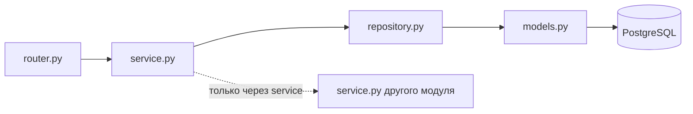

<div align="center">

# 💄 Kumurska

**Бэкенд и клиентские приложения бонусной программы Kumurska Cosmetics**

[](https://github.com/Dantikal/Kumurska/actions/workflows/api-ci.yml)


[Быстрый старт](#-быстрый-старт) •
[Команды](#-команды) •
[Архитектура](#-архитектура) •
[Формат ошибок](#-формат-ошибок) •
[Как участвовать](#-как-участвовать)

</div>

---

## 📁 Структура

```text
kumurska/
├── apps/
│   ├── mobile/            # мобильное приложение
│   └── admin/             # веб-админка
├── services/
│   ├── api/               # основной бэкенд (FastAPI)
│   └── integration-1c/    # интеграция с 1С
├── packages/              # общий код и типы
├── docs/
│   └── adr/               # архитектурные решения
└── infra/                 # инфраструктура и деплой
```

## 🛠 Стек бэкенда

| Слой | Технологии |
|---|---|
| Язык | Python 3.12 |
| Веб-фреймворк | FastAPI |
| База данных | PostgreSQL, SQLAlchemy 2, Alembic |
| Кэш и очереди | Redis |
| Качество кода | pytest, Ruff |

## 🚀 Быстрый старт

> [!NOTE]
> Нужны **Python 3.12** и **Docker**.

```bash
# 1. Поднять PostgreSQL и Redis (из корня репозитория)
docker compose up -d

# 2. Установить зависимости
cd services/api
python -m venv .venv
source .venv/bin/activate        # Windows: .venv\Scripts\activate
pip install -e ".[dev]"

# 3. Создать локальные настройки
cp .env.example .env             # Windows: copy .env.example .env

# 4. Применить миграции и запустить API
alembic upgrade head
uvicorn app.main:app --reload
```

После запуска:

- 📖 документация API — <http://localhost:8000/docs>
- ❤️ проверка работы — <http://localhost:8000/health>

## ⌨️ Команды

Выполняются из `services/api`.

| Команда | Что делает |
|---|---|
| `pytest` | запускает тесты |
| `ruff check .` | проверяет код линтером |
| `ruff format .` | форматирует код |
| `alembic revision --autogenerate -m "описание"` | создаёт миграцию |
| `alembic upgrade head` | применяет миграции |

## 🏛 Архитектура

`services/api` построен как **модульный монолит** ([ADR-0001](docs/adr/0001-modular-monolith.md)).
Код каждого модуля лежит в `app/modules/<модуль>/`:

| Файл | Назначение |
|---|---|
| `router.py` | HTTP-методы: только приём запроса и ответ |
| `schemas.py` | схемы запросов и ответов |
| `service.py` | бизнес-логика и транзакции |
| `repository.py` | запросы к базе данных |
| `models.py` | таблицы SQLAlchemy |

**Модули:** `auth` · `users` · `loyalty` · `purchases` · `content` · `notifications` · `admin`



> [!IMPORTANT]
> **Правила**
> 1. Модуль вызывает другой модуль только через его `service.py`.
> 2. Баланс баллов меняется только через модуль `loyalty`.
> 3. Все маршруты API начинаются с `/api/v1`.
> 4. Изменение схемы БД всегда сопровождается миграцией.

## ⚠️ Формат ошибок

Все ошибки API возвращаются в одном формате:

```json
{
  "error": {
    "code": "OTP_INVALID",
    "message": "Неверный код",
    "details": {}
  }
}
```

Клиенты опираются на `code`. В коде ошибка вызывается так:

```python
raise ApiError(400, "OTP_INVALID", "Неверный код")
```

## 🤝 Как участвовать

Порядок работы с ветками и pull request описан в [CONTRIBUTING.md](CONTRIBUTING.md).

---

<div align="center">
<sub>Kumurska Cosmetics • бонусная программа</sub>
</div>
