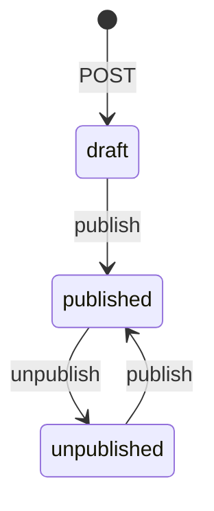

# Админка: акции и события (US-17)

Методы для управления акциями и событиями. Полный контракт со схемами — в
[openapi/openapi.json](openapi/openapi.json), тег `admin: content`.

## Доступ

Все методы начинаются с `/api/v1/admin/content` и доступны только сотруднику с ролью
`content_manager`. Токен передаётся в заголовке `Authorization: Bearer <token>`.

| Ситуация | Ответ |
|---|---|
| нет токена сотрудника | `401 NOT_AUTHENTICATED` |
| сотрудник без роли `content_manager` | `403 FORBIDDEN` |

> [!WARNING]
> Вход сотрудников появится в US-36. До этого все методы отвечают `401`: контракт
> финальный, его можно использовать для вёрстки и моков.

## Методы

Для акций (`promotions`) и событий (`events`) набор одинаковый.

| Метод | Что делает | Успех |
|---|---|---|
| `GET /promotions` | список всех акций, включая черновики, от новых к старым | 200 |
| `POST /promotions` | создать акцию, всегда в статусе `draft` | 201 |
| `GET /promotions/{id}` | одна акция | 200 |
| `PATCH /promotions/{id}` | изменить поля | 200 |
| `POST /promotions/{id}/publish` | опубликовать | 200 |
| `POST /promotions/{id}/unpublish` | снять с публикации | 200 |
| `GET /events` … `POST /events/{id}/unpublish` | то же для событий | |
| `POST /images` | загрузить изображение, вернуть `image_url` | 201 |

Удаления нет: снятая с публикации запись остаётся в базе и видна в админке.

### Список

Параметры запроса:

| Параметр | Что делает |
|---|---|
| `status` | `draft`, `published` или `unpublished`; без него — все |
| `q` | поиск по названию без учёта регистра, 1–255 символов |
| `limit` | 1–100, по умолчанию 20 |
| `cursor` | `next_cursor` из предыдущей страницы |

Ответ: `{"items": [...], "next_cursor": "..." | null}`. `next_cursor: null` — страниц больше нет.
Неверный курсор → `400 INVALID_CURSOR`.

### Поля

| Поле | Акция | Событие | Комментарий |
|---|---|---|---|
| `title` | обязательно | обязательно | 1–255 символов, пробелы по краям обрезаются |
| `description` | да | — | |
| `image_url` | да | да | значение из `POST /images` |
| `starts_at` | да | да | ISO 8601 с часовым поясом, например `2026-12-01T09:00:00+06:00` |
| `ends_at` | да | да | позже `starts_at` |
| `is_period` | — | да | по умолчанию `false` |

Ответ дополнительно содержит `id`, `status`, `created_at`, `updated_at`.

Черновик можно сохранить без сроков и дописать позже. `status` в теле передавать нельзя: он
меняется только через `publish` и `unpublish`.

В `PATCH` передаются только изменяемые поля. `null` очищает необязательное поле, `title`
очистить нельзя. Изменения опубликованной записи сразу видны клиентам.

### Статусы



Клиентское приложение показывает только `published`. Любой другой переход →
`409 INVALID_STATUS_TRANSITION`, в `details` текущий и запрошенный статус:
`{"from": "draft", "to": "unpublished"}`.

Для публикации нужны: у акции `title`, `starts_at` и `ends_at`, у события `title` и `starts_at`.
Если чего-то нет → `422 VALIDATION_ERROR` со списком полей:

```json
{
  "error": {
    "code": "VALIDATION_ERROR",
    "message": "Некорректные данные",
    "details": {"fields": [{"field": "ends_at", "message": "Обязательно для публикации"}]}
  }
}
```

У опубликованной или снятой с публикации записи эти поля нельзя очистить через `PATCH`: тоже `422`.

### Изображения

`POST /images`, `multipart/form-data`, поле `file`. Ответ: `{"image_url": "https://..."}`.
Полученный `image_url` передаётся в `POST` или `PATCH` акции или события.

- Форматы: JPEG, PNG, WebP. Тип определяется по содержимому файла, а не по расширению.
- Размер: не больше 5 МБ.
- Имя файла генерирует сервер, имя от клиента не сохраняется.

| Ошибка | Когда |
|---|---|
| `422 UNSUPPORTED_IMAGE_TYPE` | не JPEG, PNG или WebP |
| `422 IMAGE_TOO_LARGE` | больше 5 МБ |
| `422 VALIDATION_ERROR` | нет поля `file` |
| `503 IMAGE_STORAGE_UNAVAILABLE` | хранилище недоступно, можно повторить |

## Остальные ошибки

| Код | Когда |
|---|---|
| `404 PROMOTION_NOT_FOUND`, `404 EVENT_NOT_FOUND` | нет записи с таким `id` |
| `422 VALIDATION_ERROR` | неверное тело или параметры, `ends_at` не позже `starts_at` |

Формат ошибок общий для API, см. [README](../README.md#-формат-ошибок).
