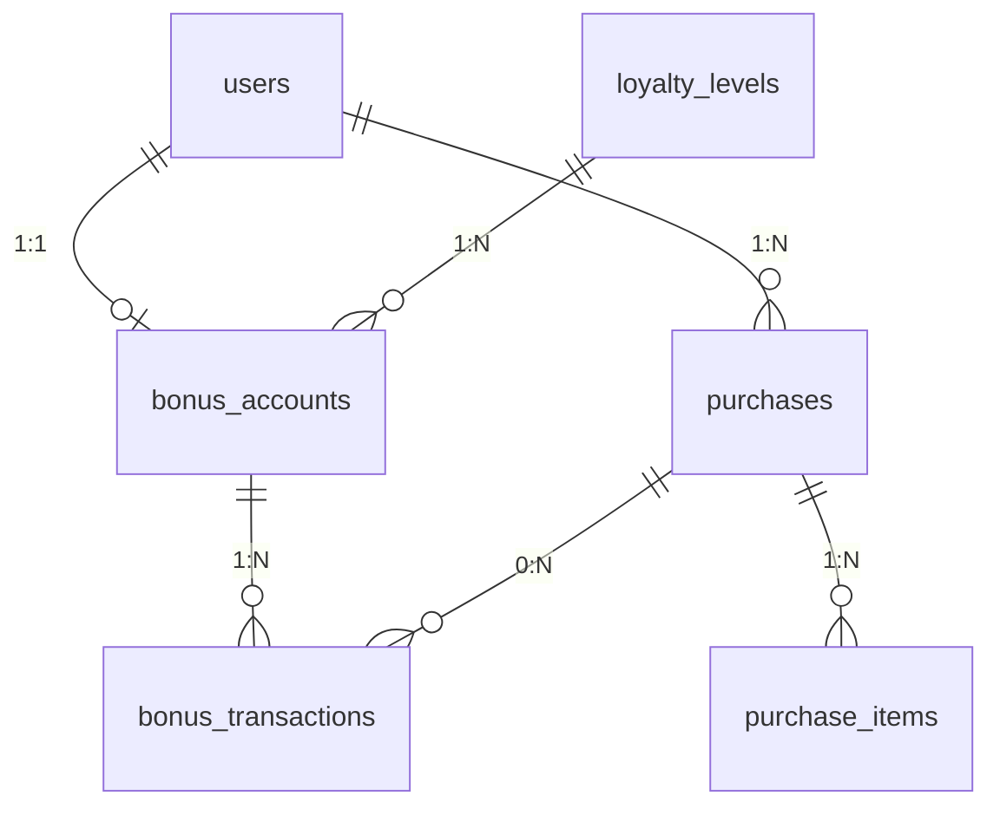

# Модель данных US-01

## Общие правила

- Первичные ключи — `UUID`.
- У всех таблиц, кроме `bonus_transactions`, есть `created_at` и `updated_at` (`TIMESTAMPTZ`).
- Деньги и пороги — `NUMERIC(12, 2)`; кешбэк — `NUMERIC(5, 2)`; баллы — целые.
- Статусы — `Enum(..., native_enum=False)`; в базе хранятся **значения** (`active`, `blocked`, ...).
- Внешние ключи между модулями задаются строкой (`ForeignKey("users.id")`).

## Таблицы

### `users`

| Поле | Тип | Ограничения |
|---|---|---|
| `id` | UUID | PK |
| `phone` | VARCHAR(20) | UNIQUE, NOT NULL |
| `name` | VARCHAR(100) | NOT NULL |
| `birth_date` | DATE | NOT NULL |
| `password_hash` | VARCHAR(255) | NULL |
| `status` | ENUM | `active` / `blocked` / `deleted`, default `active` |
| `created_at`, `updated_at` | TIMESTAMPTZ | NOT NULL |

### `loyalty_levels`

| Поле | Тип | Ограничения |
|---|---|---|
| `id` | UUID | PK |
| `name` | VARCHAR(100) | NOT NULL |
| `cashback_percent` | NUMERIC(5, 2) | CHECK 0–100 |
| `threshold` | NUMERIC(12, 2) | NOT NULL |
| `effective_from` | TIMESTAMPTZ | NOT NULL |
| `status` | ENUM | `active` / `archived` |
| `created_at`, `updated_at` | TIMESTAMPTZ | NOT NULL |

### `bonus_accounts`

| Поле | Тип | Ограничения |
|---|---|---|
| `id` | UUID | PK |
| `user_id` | UUID | FK → `users.id`, UNIQUE |
| `level_id` | UUID | FK → `loyalty_levels.id` |
| `balance` | INT | default 0 |
| `accumulated_total` | NUMERIC(12, 2) | default 0 |
| `level_expires_at` | TIMESTAMPTZ | NULL |
| `status` | ENUM | `active` / `closed` |
| `created_at`, `updated_at` | TIMESTAMPTZ | NOT NULL |

### `bonus_transactions`

| Поле | Тип | Ограничения |
|---|---|---|
| `id` | UUID | PK |
| `account_id` | UUID | FK → `bonus_accounts.id` |
| `purchase_id` | UUID | FK → `purchases.id`, NULL |
| `type` | ENUM | `accrual` / `redemption` / `refund` / `adjustment` |
| `amount` | INT | со знаком |
| `reason` | VARCHAR(255) | NULL |
| `status` | ENUM | `pending` / `confirmed` / `cancelled` |
| `created_at` | TIMESTAMPTZ | NOT NULL |

> **Без `updated_at`** — журнал неизменяем.

### `purchases`

| Поле | Тип | Ограничения |
|---|---|---|
| `id` | UUID | PK |
| `user_id` | UUID | FK → `users.id` |
| `source` | VARCHAR(50) | NOT NULL |
| `external_id` | VARCHAR(100) | NOT NULL |
| `receipt_number` | VARCHAR(100) | NULL |
| `total_amount` | NUMERIC(12, 2) | NOT NULL |
| `paid_amount` | NUMERIC(12, 2) | NOT NULL |
| `purchased_at` | TIMESTAMPTZ | NOT NULL |
| `status` | ENUM | `pending` / `confirmed` / `refunded` |
| `created_at`, `updated_at` | TIMESTAMPTZ | NOT NULL |

UNIQUE `(source, external_id)`.

### `purchase_items`

| Поле | Тип | Ограничения |
|---|---|---|
| `id` | UUID | PK |
| `purchase_id` | UUID | FK → `purchases.id` |
| `name` | VARCHAR(255) | NOT NULL |
| `quantity` | INT | NOT NULL |
| `unit_price` | NUMERIC(12, 2) | NOT NULL |
| `line_total` | NUMERIC(12, 2) | NOT NULL |
| `created_at`, `updated_at` | TIMESTAMPTZ | NOT NULL |

### `promotions`

| Поле | Тип | Ограничения |
|---|---|---|
| `id` | UUID | PK |
| `title` | VARCHAR(255) | NOT NULL |
| `description` | TEXT | NULL (US-9 — только при наличии) |
| `image_url` | VARCHAR(500) | NULL |
| `starts_at` | TIMESTAMPTZ | NOT NULL |
| `ends_at` | TIMESTAMPTZ | NOT NULL |
| `status` | ENUM | `draft` / `published` / `unpublished` |
| `created_at`, `updated_at` | TIMESTAMPTZ | NOT NULL |

### `events`

| Поле | Тип | Ограничения |
|---|---|---|
| `id` | UUID | PK |
| `title` | VARCHAR(255) | NOT NULL |
| `image_url` | VARCHAR(500) | NULL |
| `starts_at` | TIMESTAMPTZ | NOT NULL |
| `ends_at` | TIMESTAMPTZ | NULL |
| `is_period` | BOOLEAN | default `false` |
| `status` | ENUM | `draft` / `published` / `unpublished` |
| `created_at`, `updated_at` | TIMESTAMPTZ | NOT NULL |

## Связи



## Вычисляемые поля в API (в БД отсутствуют)

- `points_redeemed` — сумма `bonus_transactions.amount` с `type=redemption` по покупке.
- `cashback_earned` — сумма `bonus_transactions.amount` с `type=accrual` по покупке.

## Формат ошибок

```json
{ "error": { "code": "NOT_IMPLEMENTED", "message": "...", "details": {} } }
```

## Пагинация

Все списки возвращают `{ "items": [...], "next_cursor": null }` и принимают `cursor` + `limit` (1–100, по умолчанию 20).